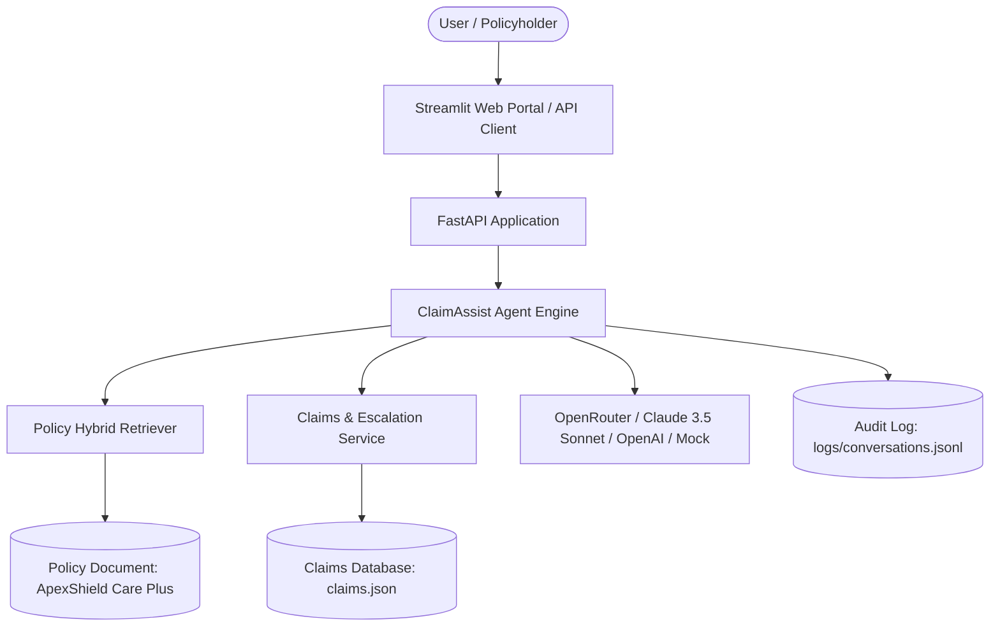

# 🛡️ ClaimAssist AI — Intelligent Health Insurance Claim Adjudication & Support

[](https://www.python.org/downloads/)
[](https://fastapi.tiangolo.com)
[](https://streamlit.io)
[](https://openrouter.ai)
[]()

**ClaimAssist AI** is an enterprise-grade AI conversational platform for healthcare insurance adjudication, policy explanation, claims status tracking, benefit calculations, and human specialist escalation. Built specifically around the **ApexShield Care Plus** policy.

---

## 🌟 Key Features

1. **Strictly Grounded Policy RAG**:
   - Parses the complete **ApexShield Care Plus** policy into structured, cited chunks.
   - Hybrid TF-IDF vector similarity combined with exact section code matching.
   - Every answer guarantees verified citations (e.g., `[Section 2.1]`, `[Section 3.2]`, `[Section 4.1]`, `[Section 8.2]`).
   - Zero hallucination policy: explicitly communicates exclusions and waiting periods.

2. **Real-time Claim Adjudication & Tracking**:
   - Direct integration with customer claims registry (`data/claims.json`).
   - Look up claims (`CLM1001` - `CLM1006`) by Claim ID or Policyholder.
   - Real-time status reporting: *Approved*, *Under Review*, *Additional Documents Required*, *Rejected*, *Submitted*.

3. **Human Specialist Escalation Engine**:
   - Compliant with **Section 8.2 & 8.3** of the policy.
   - Automatically detects disputed claim denials or review delays exceeding 20 days.
   - Generates unique tracking tickets (e.g. `ESC-4A1B2C`) routed to the *Human Adjudication & Appeals Unit*.
   - Provides official phone (`1-800-555-APEX`) and email channels (`appeals@apexshield-care.example.com`).

4. **Multi-Provider LLM Engine**:
   - **OpenRouter (Primary/Recommended)**: Powered by flagship models such as `anthropic/claude-3.5-sonnet`, `meta-llama/llama-3.3-70b-instruct`, or `openai/gpt-4o`.
   - **Mock Engine (Offline/Deterministic)**: 100% offline rule-based evaluation mode with zero external API costs.
   - **OpenAI**: Native OpenAI API integration (`gpt-4o`, `gpt-4o-mini`).

5. **Interactive Streamlit Web Portal**:
   - Sleek modern portal with light/dark adaptive theme.
   - Real-time chat assistant with expandable citation inspection cards.
   - Searchable claims database and policy catalog.
   - Interactive benefit & reimbursement calculator implementing **Section 5.3**.
   - Audit trail viewer reading from `logs/conversations.jsonl`.

6. **FastAPI REST API**:
   - Comprehensive endpoints for `/api/chat`, `/api/claims`, `/api/claims/{id}/escalate`, `/api/reimbursement/calculate`, and `/api/policy/search`.

---

## 🏗️ Architecture



---

## 🚀 Quickstart Guide

### 1. Clone the Repository & Set Up Virtual Environment

```bash
git clone https://github.com/ayush300302/claim_assist_ai.git
cd claim_assist_ai

# Create and activate virtual environment (Windows)
python -m venv .venv
.\.venv\Scripts\activate

# Install dependencies
pip install -r requirements.txt
```

### 2. Configure Environment & OpenRouter API Key

Copy `.env.example` to `.env`:

```bash
cp .env.example .env
```

Edit `.env` and paste your OpenRouter API key:

```env
LLM_PROVIDER=openrouter
OPENROUTER_API_KEY=sk-or-v1-xxxxxxxxxxxxxxxxxxxx
OPENROUTER_MODEL=anthropic/claude-3.5-sonnet
OPENROUTER_BASE_URL=https://openrouter.ai/api/v1
```

> **Note**: If `OPENROUTER_API_KEY` is not provided, ClaimAssist automatically runs in deterministic **Mock Mode**, ensuring full offline functionality and zero failures.

---

## 💻 Running the Application

### Option A: Launch the Streamlit Web Application

```bash
streamlit run streamlit_app.py
```
Open your browser at `http://localhost:8501`.

### Option B: Launch the FastAPI Backend Server

```bash
uvicorn app.main:app --host 127.0.0.1 --port 8000 --reload
```
Interactive Swagger API documentation available at: `http://127.0.0.1:8000/docs`.

---

## 🧪 Running Automated Tests

Run the full pytest suite:

```bash
pytest tests/ -v
```

All 16 tests cover:
- Policy chunking & TF-IDF hybrid retrieval
- Claims lookup, search, and validation
- Reimbursement calculations under Section 5.3
- Human specialist escalation ticket creation
- Agent grounding and citation extraction
- All FastAPI REST API endpoints

---

## 📡 REST API Reference

| Method | Endpoint | Description |
|---|---|---|
| `POST` | `/api/chat` | Send message and receive grounded response with citations & tool calls |
| `GET` | `/api/claims` | List claims or filter by keyword |
| `GET` | `/api/claims/{claim_id}` | Retrieve specific claim record |
| `POST` | `/api/claims/{claim_id}/escalate` | Escalate a claim dispute or delay to a human specialist |
| `POST` | `/api/reimbursement/calculate` | Calculate co-insurance and deductible breakdown |
| `POST` | `/api/policy/search` | Semantic and keyword search across policy chunks |
| `GET` | `/api/policy/sections` | List all indexed policy sections and citations |
| `GET` | `/health` | System health check and index metrics |

---

## 📄 License

This fictional project is licensed under the MIT License.
