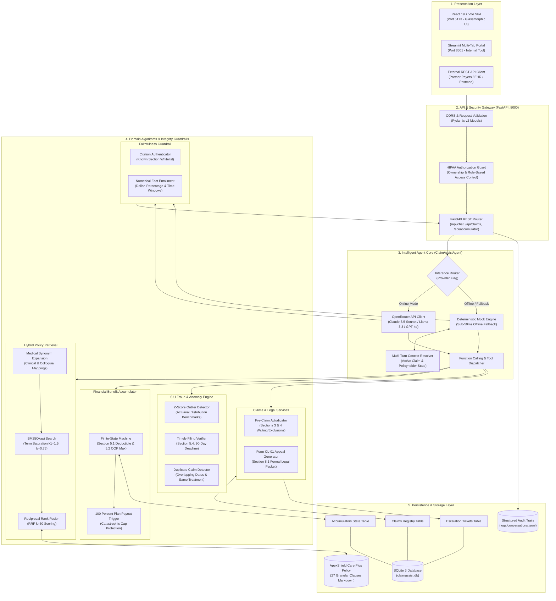

# ClaimAssist AI — High-Level Design (HLD) Specification

## 1. Executive Architecture Overview

**ClaimAssist AI** is an enterprise-grade autonomous claims adjudication, policy retrieval, and appeals platform designed for health insurers (modeled around the comprehensive 8-chapter **ApexShield Care Plus** policy).

---

## 2. High-Level Architecture Diagram (Mermaid)

---

## 3. Layer Specifications

### 3.1 Presentation Layer
- **React 19 + Vite SPA (`frontend/`)**: Modern fintech glassmorphic portal, tabbed navigation, real-time grounding audit badges, suggested prompts, and role switcher.
- **Streamlit (`streamlit_app.py`)**: Alternative analytical workspace with real-time claims and audit log reader.

### 3.2 Security & HIPAA Verification Layer
- Role-based authorization: Validates whether requester ID matches claim policyholder ID.
- Blocks unpermitted users from reading claim notes, diagnosis information, and payment disbursement accounts.

### 3.3 Agent Orchestration Layer
- **Multi-Turn Context**: Resolves pronouns and contextual follow-ups ("appeal it", "what's the status?") by scanning conversation history for prior claim entities.
- **Hybrid Inference**: Supports native OpenRouter function calling with sub-50ms offline deterministic mock engine.

### 3.4 Domain Algorithms
1. **Hybrid Retrieval**: BM25Okapi + Domain Synonym Expansion + Reciprocal Rank Fusion (RRF).
2. **Benefit Accumulator**: Stateful calculation of Deductible and Out-of-Pocket Maximum per Sections 5.1 & 5.2.
3. **SIU Anomaly Detector**: Actuarial Z-Score, 90-day timely filing check, and duplicate claim detection.
4. **Faithfulness Guardrail**: Verification of cited section legality and strict numerical fact entailment.

### 3.5 Persistence Layer
- **SQLite 3 (`data/claimassist.db`)**: Thread-safe persistent tables for `claims`, `accumulators`, and `escalations`.
